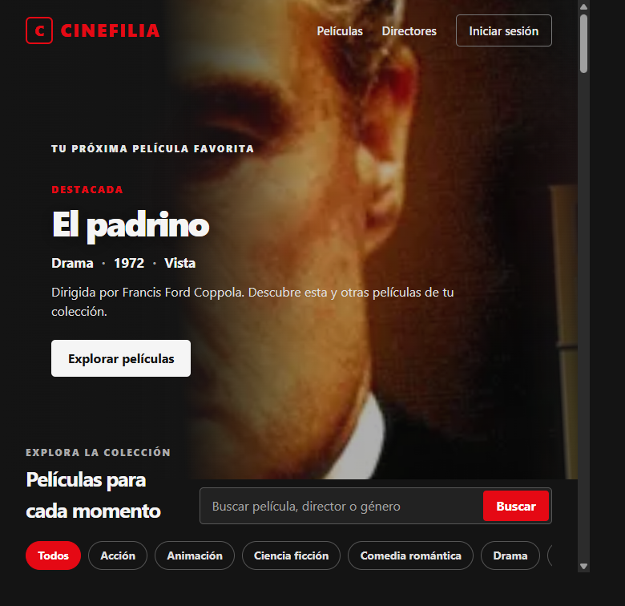
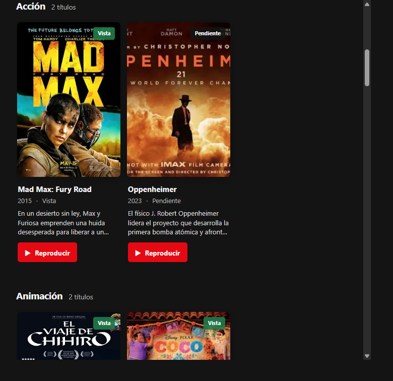
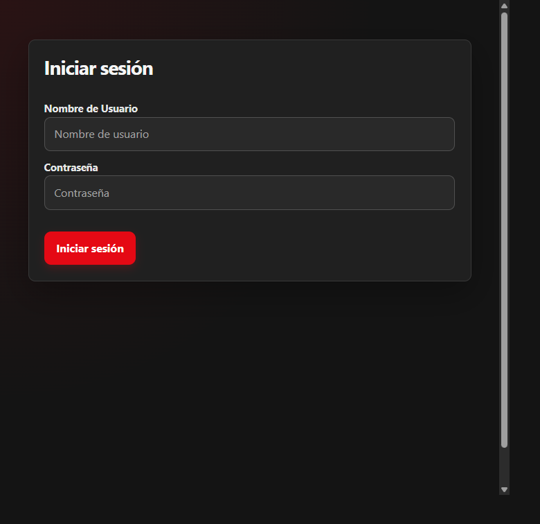

# Películas

Aplicación PHP para administrar películas y directores. Usa MySQL/MariaDB mediante PDO y está pensada para ejecutarse localmente con XAMPP.

## Captura de la web

### Portada



### Catálogo de películas



### Inicio de sesión



## Estructura del proyecto

```text
peliculas/
├── README.md
├── index.php
├── biblioteca/
│   ├── bibliotecadrawdb.png
│   └── consultas_basededatos.md
├── clases/
│   ├── director.php
│   ├── directorDao.php
│   ├── peliculas.php
│   ├── peliculasDAO.php
│   ├── usuario.php
│   └── usuarioDAO.php
├── capturas/
│   ├── catalogo.png
│   ├── inicio-sesion.png
│   └── portada.png
├── css/
│   ├── catalogo.css
│   └── panel.css
├── datos/
│   ├── .gitignore
│   ├── config.php
│   ├── config_example.php
│   ├── directores.sql
│   └── peliculas_bd.sql
├── images/
│   ├── 00675e2c00b59ef6f5730672661bd5ca.webp
│   ├── 19c43ca0ae6aa079027eafe60c7c994e.webp
│   ├── 2d096f8abc9e5f345e84e97844387a80.webp
│   ├── 32a031c94781fca35ff5654653401ce0.webp
│   ├── 5c0c8249169522c6888a9d5bfe8b28f0.webp
│   ├── 5f2a67bd2d485110d0afc4faf332d2d1.webp
│   ├── 8515956dcd5e2b01f54426ac46ac30c8.webp
│   ├── a74d7687a935504ae9906e8024e8b67d.webp
│   ├── air-ben-affleck-prime-video.webp
│   ├── ameli.webp
│   ├── bc2350e3f55fdaa5f9044f6848cdd58e.webp
│   ├── c6adec812a1848b305af64fb77676033.webp
│   ├── cd2d3def3a3332f47ffc4bf3b34477af.webp
│   ├── coco.webp
│   ├── el-diario-de-noa-l_cover.webp
│   ├── ellaberintodelfauno.webp
│   ├── elpadrino.webp
│   ├── ff9e6a938948eb13a0740600ad92b940.webp
│   ├── interstellar.webp
│   ├── lalaland.webp
│   ├── madmax.webp
│   ├── oppenheimer-23.webp
│   ├── oppenheimer-24.webp
│   ├── oppenheimer-portada-pelicula.webp
│   ├── parasitos.webp
│   ├── pelicula-el-padrino.jpg
│   ├── resumen-pelicula-el-viaje-de-chihiro.jpg.webp
│   └── tiburon-pelicula-68221d02a0f4f.webp
└── panel/
    ├── cerrar.php
    ├── index.php
    ├── login.php
    ├── perfil.php
    ├── director/
    │   ├── crearDirector.php
    │   ├── eliminarDirector.php
    │   └── formDirector.php
    ├── pelicula/
    │   ├── crearPelicula.php
    │   ├── eliminarPelicula.php
    │   └── formPeliculas.php
    └── usuario/
        ├── crearUsuario.php
        ├── eliminarUsuario.php
        └── formUsuario.php
```

### Contenido de cada parte

- `index.php`: portada pública. Lee las películas, las agrupa por género y muestra búsqueda, filtros, sinopsis y carátulas.
- `clases/`: modelos de película, director y usuario, junto con sus clases DAO. Los DAO conectan con MySQL/MariaDB mediante PDO y realizan las consultas.
- `css/`: `catalogo.css` da estilo a la portada; `panel.css` da estilo al inicio de sesión, panel, perfil y formularios.
- `datos/`: configuración de conexión y scripts SQL. `config.php` es local y no debe publicarse. `.gitignore` evita que se suba ese archivo.
- `images/`: carátulas que se muestran en el catálogo y en el panel. Las películas guardan en la base de datos el nombre del archivo, no la imagen.
- `panel/`: páginas de administración, acceso y perfil. Las subcarpetas `director/`, `pelicula/` y `usuario/` contienen los formularios y acciones de cada tipo de registro.
- `biblioteca/`: documentación de referencia. `consultas_basededatos.md` contiene ejercicios SQL de una biblioteca de libros y no se usa en Cinefilia. `bibliotecadrawdb.png` es un diagrama de referencia.
- `capturas/`: imágenes de la aplicación para la presentación: portada, catálogo e inicio de sesión.

## Puesta en marcha

1. Coloca el proyecto dentro de `C:\xampp\htdocs\peliculas`.
2. Inicia Apache y MySQL en XAMPP y crea una base de datos llamada `peliculas_bd`.
3. Importa `datos/peliculas_bd.sql` desde phpMyAdmin. Hazlo una sola vez en una base nueva; crea las tablas `director` y `peliculas`.
4. Si todavía no tienes `datos/config.php`, copia `datos/config_example.php` como `datos/config.php` y configura `$servidor`, `$nombreBase`, `$usuario` y `$password` para tu instalación.
5. Abre `http://localhost/peliculas/` para explorar el catálogo o `http://localhost/peliculas/panel/` para administrar el contenido.

El usuario y contraseña de MySQL dependen de la instalación local. No compartas ni subas `datos/config.php` con credenciales reales.


## Publicar la aplicación en internet

El proyecto necesita un servidor que ejecute PHP, soporte PDO para MySQL y permita conectar con una base de datos MySQL/MariaDB. Además, la carpeta `images/` debe permitir guardar las carátulas que se suban.

**Subir `index.php` no basta para que Vercel o Netlify ejecuten PHP.** Vercel no tiene un runtime PHP nativo, aunque permite desplegar contenedores Docker; Netlify no ofrece alojamiento PHP clásico. En Vercel se podría preparar un contenedor para PHP, pero esta aplicación también necesitaría una base MySQL externa y almacenamiento persistente externo para las carátulas. Las sesiones de PHP también deben tener en cuenta que el servidor puede ser temporal.

Por eso, antes de publicar, hay que preparar la configuración específica de Vercel y contratar o configurar esos servicios externos. La configuración de XAMPP y `datos/config.php` local no debe subirse tal cual.

Para publicar el proyecto tal como está, usa un alojamiento que incluya PHP y MySQL/MariaDB (por ejemplo, un plan de hosting con PHP o un servidor propio). Allí tendrás que:

1. Subir los archivos a la carpeta pública del servidor.
2. Crear la base de datos e importar `datos/peliculas_bd.sql`.
3. Crear también la tabla `usuario`, que no está incluida en el SQL actual.
4. Configurar las credenciales de producción en `datos/config.php` sin publicarlas en Git.
5. Comprobar que PHP tenga habilitado PDO MySQL y que `images/` permita guardar archivos.

## Cómo está organizado el código

### Modelos en `clases/`

- `Director`: guarda `id`, `nombre`, `anioNacimiento` y `biografia`. Su constructor recibe nombre, nacimiento, biografía e ID opcional. Los getters (`getNombre()`, `getAnioNacimiento()`, etc.) leen sus datos y los setters los modifican.
- `peliculas`: guarda `id`, `titulo`, `director`, `anio`, `genero`, `imagen` y `visto`. Su constructor recibe esos datos; los getters y setters permiten consultarlos y actualizarlos.
- `Usuario`: guarda `id`, `nombre`, `password` y `rol`. La contraseña se guarda cifrada con `password_hash()`.

### Acceso a datos

`directorDao`, `peliculasDAO` y `usuarioDAO` abren una conexión PDO usando las variables de `datos/config.php`.

Los DAO de películas y directores ofrecen:

- `getAll()`: devuelve todos los registros como objetos.
- `getById($id)`: busca uno por ID; devuelve `null` si no existe.
- `actualizar($objeto)`: actualiza un registro.
- `eliminar($id)`: borra por ID.

Para crear registros se usan `setDirector($director)` y `setPelicula($pelicula)`. Las consultas preparadas enlazan los datos para las operaciones por ID.

`usuarioDAO` también comprueba nombres repetidos (`existeNombre()`), crea usuarios (`setUsuario()`), actualiza y elimina usuarios, y valida el inicio de sesión (`existeUsuario()`).

### Panel y formularios

- `panel/login.php`: muestra el formulario de acceso. `panel/index.php` valida el usuario y mantiene la sesión.
- `panel/index.php`: muestra las listas de películas y directores con `?vista=peliculas` o `?vista=directores`. La gestión de usuarios usa `?vista=usuarios` y está destinada al rol de administrador.
- `panel/perfil.php`: permite cambiar el nombre y la contraseña de la cuenta activa. El rol se muestra, pero solo un administrador puede cambiarlo desde la gestión de usuarios.
- `panel/cerrar.php`: cierra la sesión.
- `index.php`: muestra películas en filas por género, con carátulas grandes, sinopsis, búsqueda y filtros. El botón de reproducción indica cuando la película no tiene un vídeo asociado; el catálogo actual no guarda fuentes de vídeo.
- `panel/usuario/crearUsuario.php` y `panel/usuario/formUsuario.php`: crean o modifican usuarios y muestran un aviso si el nombre ya está en uso.
- `panel/director/formDirector.php` y `panel/pelicula/formPeliculas.php`: muestran formularios nuevos o cargan un registro cuando reciben `?id=...`.
- `panel/director/crearDirector.php` y `panel/pelicula/crearPelicula.php`: reciben los datos del formulario y crean o actualizan según venga un ID.
- `panel/director/eliminarDirector.php`, `panel/pelicula/eliminarPelicula.php` y `panel/usuario/eliminarUsuario.php`: reciben el ID, eliminan el registro y vuelven al listado correspondiente.

### Subida de carátulas

El formulario de películas usa `multipart/form-data`. `subirImagen()` en `panel/pelicula/crearPelicula.php` valida el archivo (JPG, PNG, WEBP o GIF, máximo 5 MB) y lo guarda en `images/` con un nombre formado por el título normalizado, el ID de la película y la extensión (por ejemplo, `amelie-12.webp`). `generarNombreImagen()` elimina acentos y caracteres especiales y sustituye los espacios por guiones. En la base de datos se guarda el nombre del archivo, no su contenido. Al editar, si no se selecciona otra imagen, se conserva la existente.

`css/panel.css` da estilo al listado y a los formularios. Las carátulas se sirven desde `images/`.

## Documentación de funciones y métodos

Las clases PHP incluyen PHPDoc sobre cada método para explicar su propósito, los datos que recibe y lo que devuelve. Resumen:

### Modelos

- `peliculas::__construct()` inicializa todos los datos de una película. `getId()`, `getTitulo()`, `getDirector()`, `getAnio()`, `getGenero()`, `getImagen()` y `getVisto()` consultan cada propiedad. Los métodos `setId()`, `setTitulo()`, `setDirector()`, `setAnio()`, `setGenero()`, `setImagen()` y `setVisto()` actualizan la propiedad correspondiente.
- `Director::__construct()` inicializa los datos de un director. `getId()`, `getNombre()`, `getAnioNacimiento()` y `getBiografia()` consultan sus propiedades; `setId()`, `setNombre()`, `setAnionacimiento()` y `setBiografia()` las actualizan. `__toString()` genera una frase con el nombre y el año de nacimiento.

### Acceso a datos

- En `peliculasDAO`, `__construct()` abre la conexión a MySQL/MariaDB; `getAll()` recupera todas las películas; `getById()` busca una por ID; `setPelicula()` inserta una y devuelve el ID generado; `actualizar()` modifica una película existente; `eliminar()` borra una por ID.
- En `directorDao`, `__construct()` abre la conexión a la base de datos; `getAll()` recupera todos los directores; `getById()` busca uno por ID; `setDirector()` inserta un director; `actualizar()` modifica uno existente; `eliminar()` borra uno por ID.

### Funciones de carátulas

- `generarNombreImagen($titulo, $id, $extension)` convierte el título a texto ASCII, lo pasa a minúsculas, reemplaza los grupos de caracteres especiales por guiones y añade el ID y la extensión. Si el título queda vacío, usa `pelicula`.
- `subirImagen($archivo, $titulo, $id)` devuelve `null` si no se seleccionó archivo. En caso contrario, valida el error de subida, el límite de 5 MB, el tipo real de imagen y la carpeta de destino; después guarda el archivo con el nombre generado y lo devuelve. Si falla una validación o el guardado, lanza `RuntimeException`.

### Scripts del panel

Los siguientes archivos ejecutan su lógica directamente al abrirse o al recibir el formulario; no declaran funciones propias:

- `panel/index.php` selecciona la vista solicitada, obtiene las películas o los directores desde su DAO y genera la tabla correspondiente.
- `panel/pelicula/formPeliculas.php` y `panel/director/formDirector.php` muestran el formulario vacío o cargan los datos del registro indicado por `id`.
- `panel/pelicula/crearPelicula.php` crea o actualiza la película, gestiona la carátula y redirige al listado. Si al crear falla la subida, elimina el registro recién insertado para no dejar una película incompleta.
- `panel/director/crearDirector.php` crea o actualiza un director y redirige al listado.
- `panel/pelicula/eliminarPelicula.php` y `panel/director/eliminarDirector.php` leen el ID, eliminan el registro correspondiente y vuelven al listado.
